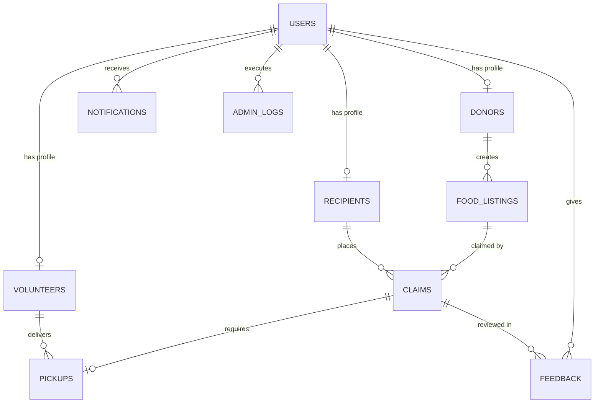

# 🍲 FoodBridge — Urban Food Waste Redistribution System

**FoodBridge** is a full-stack web application designed to eliminate urban food waste by seamlessly connecting surplus food donors (restaurants, hotels, grocery stores, households, event organizers) with recipient organizations (NGOs, shelters, community kitchens, individuals in need) and volunteer drivers.

---

## 🌟 Features Overview

- **Multi-Role Access Control (RBAC)**:
  - 🏨 **Donors**: Create/manage surplus food listings with quantity, category, expiration countdowns, and pickup map coordinates.
  - 🤝 **Recipients / NGOs**: Discover food filtered by dietary category (Veg/Non-Veg/Packaged), sort by urgency (*Expiring Soonest*) or distance, and claim food.
  - 🚚 **Volunteers**: View dispatch delivery queue, track routes on interactive maps, and update pickup/delivery progress.
  - 👑 **Admins**: Verify donor and NGO organizations, view real-time impact analytics (food saved in kg, meals served, CO₂ emissions prevented), and audit log trails.
- **Automated Food Expiry Handling**: Background cron worker automatically marks listings past their safe consumption window as `EXPIRED` and notifies donors.
- **Smart Location & Urgency Matching**: Haversine distance algorithm calculates real-time proximity in kilometers and flags urgent items (< 4 hours remaining).
- **Interactive Maps**: Powered by Leaflet maps with custom pins for pickup locations.
- **Impact Analytics**: Charts generated with Recharts showing food waste reduction trends over time.

---

## 🗄️ Relational Database & DBMS Design Decisions

### 1. Normalization (3NF Minimum)
The database is normalized to **Third Normal Form (3NF)** to ensure zero transitive dependencies and prevent data duplication:
- **`users`**: Central authentication table storing common identity attributes (`id`, `email`, `password_hash`, `role`).
- **`donors`**, **`recipients`**, **`volunteers`**: Specific role profile tables linked to `users(id)` via 1:1 foreign keys with `ON DELETE CASCADE`.
- **`food_listings`**: Stores food item metadata linked to `donors(id)` via 1:N foreign key.
- **`claims`**: Junction table mapping food claims between `food_listings(id)` and `recipients(id)` with `claimed_at` timestamps.
- **`pickups`**: Manages dispatch logistics linked to `claims(id)` with 1:1 foreign key and optional `volunteer_id`.
- **`feedback`**, **`notifications`**, **`admin_logs`**: Auxiliary audit and activity tables.

### 2. Indexes & Performance Optimization
Performance indexes are created on frequently queried columns:
- `food_listings(status, expiry_time)`: Rapid filtering of active & unexpired food items.
- `food_listings(pickup_lat, pickup_lng)`: Geographic spatial queries.
- `claims(recipient_id)`, `pickups(volunteer_id)`: Fast dashboard lookups.
- `notifications(user_id, is_read)`: Fast unread notification badge calculation.

---

## 📊 Entity-Relationship (ER) Diagram



---

## 🚀 Quick Setup & Installation Guide

### Prerequisites
- Node.js (v18+) & npm

### 1. Backend Setup
```bash
cd backend
npm install
npx prisma db push
node prisma/seed.js
npm start
```
*Backend server will start at `http://localhost:5000`*

### 2. Frontend Setup
```bash
cd frontend
npm install
npm run dev
```
*Frontend application will run at `http://localhost:3000`*

---

## 🔑 One-Click Demo Credentials

| Role | Email | Password |
| :--- | :--- | :--- |
| **System Admin** | `admin@foodbridge.org` | `password123` |
| **Donor (Hotel)** | `grandhyatt@donor.com` | `password123` |
| **Donor (Grocery)** | `freshmart@donor.com` | `password123` |
| **Recipient (NGO)** | `hopehaven@ngo.org` | `password123` |
| **Volunteer Driver** | `alex@volunteer.com` | `password123` |

---

## 🔌 REST API Endpoints Overview

| Method | Endpoint | Description | Auth Required |
| :--- | :--- | :--- | :--- |
| `POST` | `/api/auth/register` | Register new user (Donor/NGO/Volunteer) | No |
| `POST` | `/api/auth/login` | Login & receive JWT | No |
| `GET` | `/api/auth/me` | Fetch active user profile | Yes |
| `GET` | `/api/listings` | Fetch food listings (filter by category, urgency, distance) | No |
| `POST` | `/api/listings` | Create food listing | Yes (Donor/Admin) |
| `DELETE` | `/api/listings/:id` | Delete food listing | Yes (Donor/Admin) |
| `POST` | `/api/claims` | Claim an available food listing | Yes (Recipient) |
| `GET` | `/api/claims` | List user claims | Yes |
| `GET` | `/api/pickups` | View volunteer dispatch queue | Yes (Volunteer/Admin) |
| `PATCH` | `/api/pickups/:id/status` | Update delivery status (`IN_TRANSIT` -> `DELIVERED`) | Yes (Volunteer/Admin) |
| `GET` | `/api/admin/analytics` | Fetch impact analytics (food saved, top donors) | Yes (Admin) |
| `PATCH` | `/api/admin/verify-org` | Verify donor or NGO organization | Yes (Admin) |
